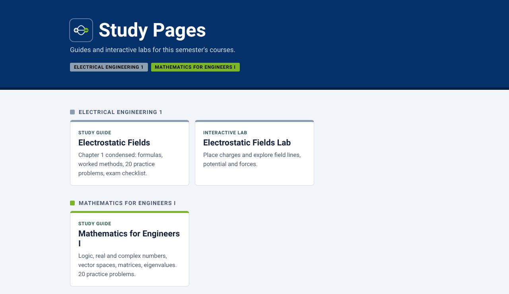

# Study Pages

Study guides and interactive labs for first-semester engineering at FAU Erlangen-Nürnberg (WS 2026/27): Electrical Engineering I and Mathematics for Engineers I.

**[Open the site →](https://unknown-x0.github.io/Autonomy-Techonologies/)**



> Personal study material written from the lecture notes. Not an official FAU publication; check anything exam-relevant against your course materials.

## What's inside

| Course | Page | What it does |
| --- | --- | --- |
| Electrical Engineering I | [Electrostatic Fields: study guide](https://unknown-x0.github.io/Autonomy-Techonologies/ee1-electrostatics-guide.html) | Chapter 1 condensed (charge to capacitors and stored energy): key formulas, worked methods, 20 practice problems, exam checklist |
| Electrical Engineering I | [Electrostatic Fields Lab](https://unknown-x0.github.io/Autonomy-Techonologies/ee1-electrostatics-lab.html) | Drag charges and sliders to see Coulomb forces, field lines, potential maps, Gauss surfaces, interfaces and capacitor networks respond live |
| Mathematics for Engineers I | [Mathematics for Engineers I: study guide](https://unknown-x0.github.io/Autonomy-Techonologies/math1-guide.html) | Logic, real and complex numbers, vector spaces, matrices, eigenvalues, least squares; 20 practice problems, exam checklist |
| Mathematics for Engineers I | [Mathematics for Engineers I Lab](https://unknown-x0.github.io/Autonomy-Techonologies/math1-lab.html) | Ten hands-on workbenches: truth tables and Venn diagrams, absolute-value inequalities, induction, injective/surjective maps, complex numbers and roots, vectors, Gauss elimination step by step, eigenvectors and least squares |

## How to study with it

1. Read one section of a guide, then cover its formulas and write them out from memory.
2. Do the matching practice problems, then open **Show answer key** to check.
3. Try the same idea in the matching lab: change one input and predict the result before you look.
4. Tick the exam checklist as each skill sticks. Ticks are saved in your browser.

Every page works on phone and desktop and follows your system's light or dark mode. The study guides also print cleanly (the side menu is hidden in print).

## Repository layout

```
index.html                      Hub page linking to every study page
ee1-electrostatics-guide.html   EEI Chapter 1 study guide
ee1-electrostatics-lab.html     EEI interactive lab
math1-guide.html                Mathematics for Engineers I study guide
math1-lab.html                  Mathematics for Engineers I interactive lab
assets/preview.png              Screenshot used in this README
```

Each page is one self-contained HTML file with no build step needed to view it. Only the fonts and the KaTeX stylesheet load from a CDN.

## How the pages are made

- **Study guides** are written in LaTeX (`Electrostatics-Study-Guide.tex`, `MathEng-I-Study-Guide.tex`, kept in the claude.ai project *Focus - Classes*), converted to HTML with pandoc, and every formula is pre-rendered with KaTeX. That makes the pages large (about 0.9 MB each) but the math shows instantly, without JavaScript.
- **The labs** are single pages with their interactive code inline. Their sources are kept in the same project and converted to the site design (FAU colours, Roboto, site bar) without changing the code.
- When a source changes, rebuild the matching page and upload it here.

## Design

- **Colours:** the FAU Erlangen-Nürnberg brand palette. FAU blue `#04316A` for headings and accents; faculty colours mark the courses: Technische Fakultät `#8C9FB1` for Electrical Engineering I, Naturwissenschaftliche Fakultät `#7BB725` for Mathematics for Engineers I. Faculty colours appear as stripes and swatches, with their darker shades (`#2F586E`, `#266141`) for text, so contrast stays readable.
- **Font:** Roboto and Roboto Mono, FAU's web typeface (Apache 2.0, via Google Fonts).
- **Site mark:** an original icon (field lines between a + and a − charge). The FAU logo is not used; it is a protected university trademark.

## Adding a page

1. Upload the `.html` file to the repo root (**Add file → Upload files**). Use a name without spaces, e.g. `ee1-chapter2-guide.html`.
2. In `index.html`, copy an existing `<a class="card …">` block and change the link, tag, name and description. Class `tf` gives the Electrical Engineering colour, `nat` the Mathematics colour. For a new course, add a new `<h2>` section.
3. Add a row to the **What's inside** table above.
4. Commit. GitHub Pages updates the site within a minute or two.

## Hosting

The site is published by **GitHub Pages with Jekyll**, straight from the `main` branch. Every commit to `main` starts GitHub's automatic **pages-build-deployment** run (see the **Actions** tab), which builds the site and publishes it within a minute or two. Each run links to the live site.

- The pages have no Jekyll front matter, so Jekyll publishes them exactly as uploaded.
- `index.html` is the homepage. `README.md` stays on GitHub and is not used as the start page.
- `.github/workflows/jekyll-docker.yml` (**Jekyll site CI**) is a separate check: it builds the site in a Jekyll container on every push and pull request, so a broken build shows up as a failed run. It does not publish anything.

Setup (once): **Settings → Pages → Build and deployment → Source: Deploy from a branch**, branch `main`, folder `/ (root)`. The repository must stay public for free Pages hosting.
